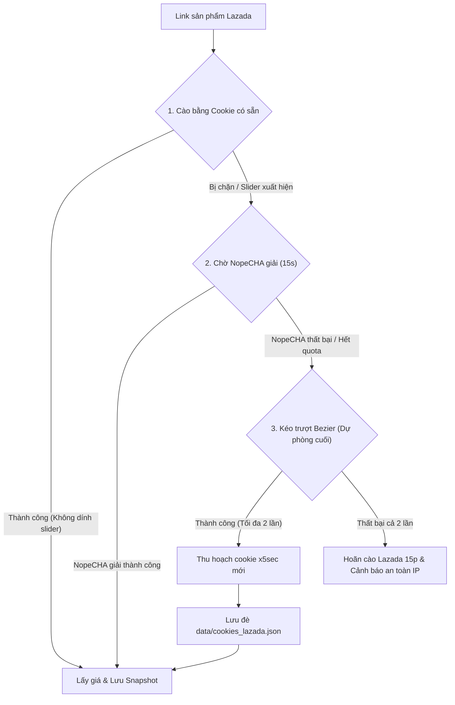

# Thiết kế kỹ thuật: Xử lý thanh trượt Captcha Lazada / Alibaba đa tầng (Tạm hoãn / Pending)

> **Tài liệu đặc tả giải pháp vượt thanh trượt NoCaptcha Slider cho sàn Lazada**  
> **Trạng thái**: 🟡 **PENDING (Tạm hoãn thực hiện)** — Đã hoàn thành vòng phản biện thiết kế (Shared Understanding qua `/grill-with-docs`), lưu trữ làm căn cứ kỹ thuật để triển khai sau khi người dùng yêu cầu.  
> **Ngày cập nhật**: 02/11/2026  

---

## 1. Bối cảnh & Vấn đề

Khi crawler quét các sản phẩm trên sàn Lazada, hệ thống kiểm soát rủi ro bảo mật của Alibaba (AWSC / NoCaptcha / Baxia / Punish) có thể can thiệp bằng cách chuyển hướng trang về `/punish` hoặc nhúng iframe chứa thanh trượt xác minh danh tính.

Hiện tại:
- Hàm `_try_drag_slider` đã có sẵn trong [`playwright.py`](file:///C:/Users/pvthien/source/deal_hunter/src/deal_hunter/adapters/playwright.py) nhưng tỷ lệ thành công chưa cao do:
  1. Tọa độ thanh trượt bị lệch khi nằm lồng sâu trong `punish` iframe.
  2. Quỹ đạo kéo chuột mang tính cơ học, thiếu gia tốc phi tuyến và rung lắc tự nhiên của tay người nên bị hệ thống chống bot của Alibaba phát hiện.
  3. Chưa có cơ chế tự động bóc tách và lưu lại cookie `x5sec` sau khi giải thành công để tái sử dụng.
  4. Logic hiện tại gọi thử kéo trượt ngay từ đầu trước khi để tiện ích NopeCHA thử sức.

---

## 2. Các quyết định thiết kế đã chốt (Architectural Decisions)

Dựa trên kết quả phản biện thiết kế với người dùng vào ngày 02/11/2026:



### Q1: Thứ tự ưu tiên đa tầng (Multi-Tier Fallback Order)
- **Tầng 1 (Ưu tiên cao nhất)**: Sử dụng phiên đăng nhập hợp lệ từ `data/cookies_lazada.json` (đặc biệt là token `x5sec` và `lzd_sid`). Khi cookie còn hạn, sàn không bao giờ hiển thị thanh trượt.
- **Tầng 2**: Nếu cookie hết hạn và thanh trượt xuất hiện, crawler dành 15 giây để tiện ích mở rộng NopeCHA tự động xử lý.
- **Tầng 3 (Dự phòng cuối cùng)**: Chỉ khi **cả Cookie lẫn NopeCHA đều không giải quyết được**, thuật toán kéo trượt mô phỏng người thật mới được kích hoạt làm chốt chặn cuối cùng.

### Q2: Tự động thu hoạch và tái sử dụng `x5sec` (Token Harvesting)
- Khi thanh trượt được giải thành công ở bất kỳ tầng nào (hoặc do người dùng giải), Playwright context sẽ lập tức trích xuất các cookie an ninh phiên mới (`x5sec`, `_tb_token_`, `lzd_sid`).
- Hệ thống tự động cập nhật ghi đè vào file `data/cookies_lazada.json` trên ổ đĩa. Toàn bộ các sản phẩm Lazada quét sau đó sẽ thừa hưởng phiên sạch này mà không bị hỏi lại thanh trượt.

### Q3: Giới hạn số lần thử & Cool-down bảo vệ IP
- Thuật toán kéo chuột chỉ thử tối đa **2 lần** cho một lượt cào.
- Nếu cả 2 lần đều không vượt qua (dấu hiệu sàn đang siết chặt dải IP mạng), hệ thống lập tức kích hoạt thời gian chờ **15 phút (cool-down)** cho phân hệ Lazada, không cố gắng cào liên tục để bảo vệ an toàn cho địa chỉ IP máy chủ.

### Q4: Nhịp độ quét (Pacing)
- Giữ nguyên cấu hình thời gian giãn cách request giữa các sản phẩm (~8 giây) theo hiện trạng, không kéo dài thêm.

---

## 3. Kế hoạch kỹ thuật chi tiết khi triển khai (Implementation Plan)

Khi người dùng yêu cầu kích hoạt lại tính năng này, các bước cụ thể gồm:

### Bước 1: Chuẩn hóa tọa độ Iframe trong `_try_drag_slider`
- Xác định bounding box của iframe cha trên trang chính kết hợp với bounding box của nút trượt `.btn_slide` / `#nc_1_n1z` bên trong iframe để tính toán tọa độ viewport chuẩn xác tuyệt đối `(start_x, start_y)`.
- Xác định chiều dài đường ray `.nc_scale` bên trong iframe để tính khoảng cách kéo `drag_distance`.

### Bước 2: Nâng cấp chuyển động chuột theo đường cong Bezier
- Sinh ngẫu nhiên 2 điểm kiểm soát $P_1, P_2$ nằm giữa điểm xuất phát $P_0$ và điểm kết thúc $P_3$.
- Sử dụng công thức đường cong Cubic Bézier:
  $$B(t) = (1-t)^3 P_0 + 3(1-t)^2 t P_1 + 3(1-t) t^2 P_2 + t^3 P_3 \quad (0 \le t \le 1)$$
- Chia thành 25 - 40 bước di chuyển với gia tốc phi tuyến (nhanh dần ở giữa, chậm lại ở cuối theo quy luật Fitts's Law).
- Thêm độ lệch vi mô ngẫu nhiên trục Y ($\pm 1 \sim 2\text{px}$) và khoảng dừng ngẫu nhiên 50 - 150ms trước khi thả chuột (`mouse.up()`).

### Bước 3: Điều chỉnh luồng gọi trong `_wait_for_captcha_solve`
- Đưa đoạn chờ NopeCHA lên trước (vòng lặp 15s).
- Nếu sau 15s vẫn còn thanh trượt và chưa vượt qua, mới gọi `self._try_drag_slider(page)` tối đa 2 lần.

### Bước 4: Tích hợp hàm `_harvest_security_tokens`
- Khi `_try_drag_slider` trả về `True` hoặc `_wait_for_captcha_solve` thành công:
  ```python
  cookies = self._ctx.cookies()
  # Trích xuất và cập nhật cookies_lazada.json
  ```

### Bước 5: Kiểm thử và xác minh
- Viết test case giả lập slider challenge trong `tests/test_adapters.py`.
- Chạy toàn bộ 186 bài test đảm bảo không hồi quy.
- Rebuild Docker container và kiểm chứng trên môi trường thực tế.

---

## 4. Tài liệu liên quan
- Thuật ngữ hệ thống: [GLOSSARY.md](file:///C:/Users/pvthien/source/deal_hunter/GLOSSARY.md) (Xem mục: *Kéo Trượt Dự Phòng Đa Tầng* & *Thu Hoạch Token An Ninh Tự Động*)
- Mã nguồn adapter: [`src/deal_hunter/adapters/playwright.py`](file:///C:/Users/pvthien/source/deal_hunter/src/deal_hunter/adapters/playwright.py)
- ADR xử lý deadlock và tắt cào Siêu Sale: [`docs/adr/0057-thread-safe-cookie-reload-and-megasale-silence.md`](file:///C:/Users/pvthien/source/deal_hunter/docs/adr/0057-thread-safe-cookie-reload-and-megasale-silence.md)
